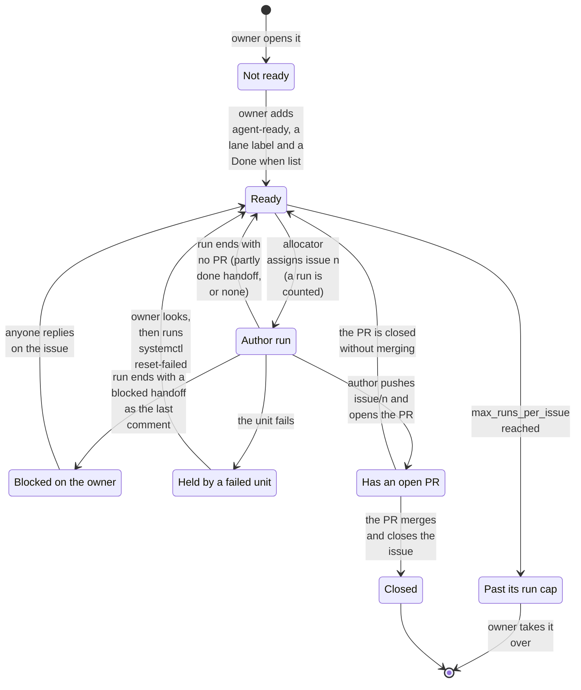
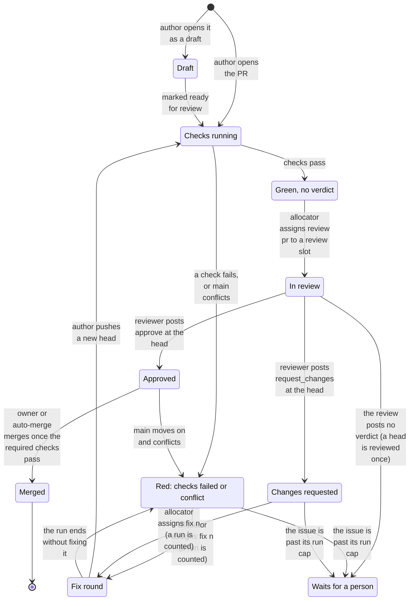
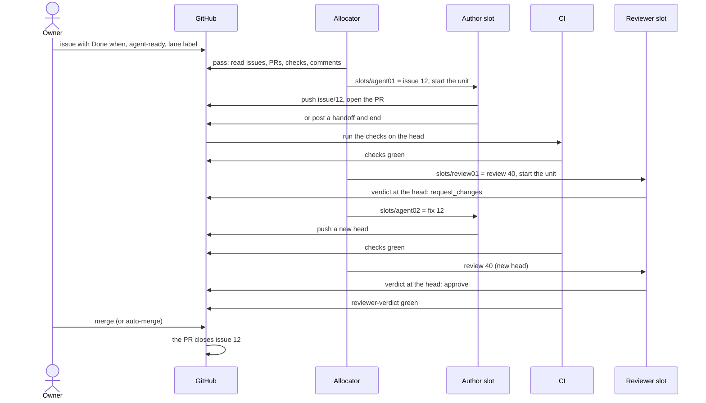

# Control plane (round 5)

What runs a few agents (four authors in round 5) on one Linux machine without them trampling each other, and lets one person stop
them. This page covers what is built: the stop switch, the write guard and Claude Code's sandbox, which protect against the rest; the
slots (an OS user, its clone and its service unit), for authors and for reviewers; who needs root (only setup);
the allocator that gives them work; and the watchdog. Setting the machine up is in [vm-setup.md](vm-setup.md).

The design is three layers. **Hooks** give an agent a clear refusal and keep it from making honest mistakes.
**Claude Code's sandbox** confines every Bash command and whatever it starts to the clone, `/tmp` and the tools'
caches, and keeps the agent's own settings and hooks read-only, even inside its home. **The agent's OS user** is
the boundary under both: each agent runs as its own user, and that user can write only its own home. A hook that
reads command lines cannot see a program that writes for itself, so a hook alone is not a sandbox; the sandbox
and the OS user are what hold.

## Environment an agent runs with

The agent's service unit sets these. On a desktop where they are unset, the hooks do nothing.

| Variable | Meaning |
|---|---|
| `FLEETWRIGHT_CLONE` | the agent's own clone. Turns on the write guard and the stop switch |
| `FLEETWRIGHT_SLOT` | the slot's name, `agentNN` or `reviewNN`; the same as the OS user |
| `FLEETWRIGHT_ROLE` | `author` or `review`; must agree with the slot's name |
| `FLEETWRIGHT_REVIEWER_LOGIN` | review slots only, from `reviewer.env`: the account verdicts must be posted as |
| `FLEETWRIGHT_SLOTS_DIR` | where assignments are read from; default `/var/lib/fleetwright/slots` |
| `FLEETWRIGHT_STOP_FILE` | the stop flag file; default `/var/lib/fleetwright/STOP` |
| `FLEETWRIGHT_ALLOW_WRITE` | extra writable directories, separated by `:` (for example a shared cache) |
| `FLEETWRIGHT_MODEL` | optional: the model the agent runs, passed as `claude --model`. Unset, Claude Code picks its default. A value that is not a plain model name stops the slot with exit 64 |

The system temp directory is always writable.

Each role has its own template unit, so to choose a role's model, give that template a drop-in as root:

```bash
sudo systemctl edit fleetwright-review@.service
```

```ini
[Service]
Environment=FLEETWRIGHT_MODEL=claude-opus-5-5
```

`fleetwright-agent@.service` takes the same drop-in for the authors. It applies to every slot of that role from its
next run, and the journal's `start model=...` line shows which model each run used.

## Stop the line

```bash
uv run --script scripts/fleetwright_stop.py stop "the deploy script is looping"
uv run --script scripts/fleetwright_stop.py status      # exit 1 while stopped
uv run --script scripts/fleetwright_stop.py clear
```

`stop` writes the flag file. [`hooks/stop_line.py`](../hooks/stop_line.py) refuses every tool call of every
agent while it exists, with the reason from the file. An agent can still answer in text, so it can say where it
stopped, but it cannot work around the stop.

- **It stops new tool calls, not running commands.** A test run that is already going finishes. Pair the flag
  file with `systemctl stop 'fleetwright-agent@*'` to end the processes.
- **The agents must not be able to clear it.** `fleetwright_slot.py init` gives `/var/lib/fleetwright` to the fleetwright-admin
  group, read-only to the agents' users, so any admin can stop and clear the line without root and no agent
  can. If an agent's user can delete the file, the stop is only a suggestion.
- **It fails closed.** If the hook cannot check the file, or crashes, the call is refused.

## Write guard

[`hooks/write_guard.py`](../hooks/write_guard.py) refuses a write whose target is outside `FLEETWRIGHT_CLONE`,
`FLEETWRIGHT_ALLOW_WRITE` or the temp directory.

It checks the `Edit`, `Write`, `MultiEdit` and `NotebookEdit` paths, with symlinks resolved, and the targets of
`Bash` commands: redirections, `tee`, `rm`, `mv`, `cp`, `touch`, `mkdir`, `sed -i`, `dd of=`, `tar -x`,
`curl -o`, `git clone`, `find -delete` and the rest of the list in the file. It follows `cd`, `sudo`/`env`
wrappers, `bash -c` and `eval` strings, `$(...)` and `find -exec`. A target it cannot work out (an unset
variable, a brace expansion, a process substitution) is refused rather than guessed.

It also protects the agent's own safety settings, even inside its clone: `.claude/settings*.json`,
`.claude/hooks/` and `.git/hooks/`. An agent that can edit them can switch the guards off. And it refuses a
`Bash` call that asks to run outside Claude Code's sandbox (`dangerouslyDisableSandbox`), with the reason.

### What it cannot see

These are allowed, on purpose, and written down as tests (`KNOWN LIMIT` in
`tests/test_evasion_write_guard.py`):

- code that writes from inside a program: `python -c`, `node -e`, `perl -i`, a build script, a test suite.
  Claude Code's sandbox confines these (next section);
- reads. An agent can read another clone's files only where the OS lets it, and the 700 homes do not;
- anything the OS lets the agent's user do outside the checkout. This is why each agent gets its own user.

## Claude Code's sandbox

`fleetwright_slot.py init` writes Claude Code's managed settings,
[`/etc/claude-code/managed-settings.json`](../claude/managed-settings.json). Claude Code reads them before any
user, project or command-line setting, and nothing below them can loosen them. The file is root's, so no slot can
change it.

| Setting | Effect |
|---|---|
| `sandbox.enabled` | every Bash command, and every process it starts, runs in bubblewrap: writes only in the clone, `/tmp` and `~/.cache`, `~/.local/share/uv` and `~/.bun`; `.claude` settings and hooks, `.git` hooks and config, and `~/.claude` stay read-only |
| `sandbox.failIfUnavailable` | without a working bubblewrap, Claude Code stops instead of running commands unsandboxed |
| `sandbox.allowUnsandboxedCommands: false` | no retry outside the sandbox. Without it, a refused command may be retried unsandboxed, and under `--dangerously-skip-permissions` that retry needs no prompt |
| `sandbox.network.allowAllUnixSockets` | skips Claude Code's seccomp helper, which blocks Unix sockets from a user namespace nested inside the sandbox. Ubuntu's `unpriv_bwrap` AppArmor profile strips that namespace's capabilities, and then every command fails. A command can reach the sockets its OS user could reach anyway (the dbus system bus, the journal, cups, snapd); the file limits still hold |
| `permissions.deny` | the file tools, which the sandbox does not cover, may not edit `~/.claude`, the clone's `.claude` settings and hooks, or `.git` hooks and config. Deny rules hold in every permission mode |
| `hooks` | the stop switch and the write guard, run from `/opt/fleetwright`, which root owns. The plugin's copies sit in the slot's own `~/.claude`; these do not |

The sandbox and the write guard allow the same directories: `HOME_WRITE` in `fleetwright_slot.py` makes both the
sandbox's `allowWrite` and the units' `FLEETWRIGHT_ALLOW_WRITE`. A command the hook allows can still fail in the
sandbox with `Operation not permitted`; that means a missing directory in `HOME_WRITE`, never a reason to turn the
sandbox off.

The sandbox keeps `.git/config` read-only, so `git push -u` cannot record an upstream. `fleetwright_agent.py` sets
`issue/<n>`'s upstream before the agent starts, and the agent pushes with a plain `git push`.

The slot check reports both halves. `bubblewrap`: it can start a sandbox under the unit's restrictions, as the
slot, and, when the managed settings leave Unix sockets closed, a user namespace inside it that keeps its
capabilities, as the seccomp helper needs. `managed settings`: the file, both hook scripts and their directory are
root's alone, and the sandbox is enabled, required and without a way out. Install `bubblewrap` and `socat` first
([vm-setup.md](vm-setup.md)).

On a machine where nothing else uses bubblewrap, such as a dedicated cloud VM, the seccomp helper can be kept:
replace Ubuntu's `bwrap-userns-restrict` profile with the one Claude Code's docs give, take `allowAllUnixSockets`
out of `managed_settings()`, and the `bubblewrap` check then probes the nested namespace.

## OS user per agent (what holds)

One user per slot, with the clone in its home (`/home/agent01/repo`) and nothing else it can write. `agentNN`
slots are authors: they work on issues and fix rounds. `reviewNN` slots are reviewers: they review pull requests
and post verdicts as the reviewer's own GitHub account. [`scripts/fleetwright_slot.py`](../scripts/fleetwright_slot.py) sets
up the machine once, then each slot:

```bash
uv run --script scripts/fleetwright_slot.py init --admin "$USER"                    # prints what it would do
sudo uv run --script scripts/fleetwright_slot.py init --admin "$USER" --apply      # the machine, once
sudo uv run --script scripts/fleetwright_slot.py add agent01 --repo https://github.com/owner/name.git \
    --git-email '123456789+g26work-fleet-authors[bot]@users.noreply.github.com' --apply
sudo uv run --script scripts/fleetwright_slot.py add review01 --repo https://github.com/owner/name.git --apply
```

Without `--apply` they only print. `init` creates the groups and users of [Who needs root](#who-needs-root),
gives `/var/lib/fleetwright` to fleetwright-admin, and installs the units in [`systemd/`](../systemd), the polkit rule and
the sshd file. `--kit` says where fleetwright is installed (default `/opt/fleetwright`). `add` creates the slot's
user in its role's group and its clone. An author's clone pushes with the App token in its unit's token file,
read at each push; a reviewer's with the token in its unit's environment, through `gh`.
An author slot also gets a commit identity in its clone: `agent01 (fleet)` at the `--git-email` address, which
should be the noreply address of the App's bot, which pushes, so GitHub links the commits to it and the name
shows which slot wrote them. `add` refuses an author slot without one.
Both run no shell, stop at the first failure, and keep a user or clone that already exists, so a slot made
before `init` existed is brought up to date by running `add` again.

The operator writes the secrets once, by hand. They are never in the repository or the unit:

```bash
sudo install -m 600 -o root -g root /dev/null /etc/fleetwright/agent.env
sudoedit /etc/fleetwright/agent.env       # ANTHROPIC_API_KEY=... only
sudo install -m 600 -o root -g root /dev/null /etc/fleetwright/reviewer.env
sudoedit /etc/fleetwright/reviewer.env    # GH_TOKEN=... (the reviewer's account) and FLEETWRIGHT_REVIEWER_LOGIN=g26work
```

The authors' GitHub access is the App's ([below](#the-authors-github-app)): its private key and ids are
`/etc/fleetwright/app.pem` and `/etc/fleetwright/app.env`, and no unit's user ever reads them.

Only the review unit reads `reviewer.env`, so an author's run never has the reviewer's token. The variable must
be `GH_TOKEN`, which `gh` prefers to `GITHUB_TOKEN`. Both the runner and `post_verdict.py` check
that `gh` is signed in as `FLEETWRIGHT_REVIEWER_LOGIN` and refuse otherwise, so a token mix-up stops a review instead of
posting an approval as someone else. The reviewer's account must be in `verdict.reviewers` in the repository's
`.fleetwright-gates.json`.

Give the reviewer's token as little as it needs: a fine-grained token that can read the repository and write
pull request comments, and cannot push or merge. A review slot runs a model over code an author wrote, with no
one watching, and its prompt is the only thing telling it not to push. The token's scope is what holds.

Each slot's home is mode 700, so one slot cannot read another's clone or transcripts. An ACL lets fleetwright-admin
read it, to look at a clone left for a person.

## The authors' GitHub App

The author slots act on GitHub through a GitHub App installed on the one repository, not through a person's
account. The App has no Administration or Workflows permission and is on no ruleset's bypass list, so no
author can change the repository's rules, merge past them, or push a change to `.github/workflows`.

| Identity | Access | Credential on the machine | Used by |
|---|---|---|---|
| the operator's account | admin | none | people |
| the App (commits as `<app>[bot]`) | this repository: contents, pull requests and issues read and write; actions, checks and statuses read | private key `/etc/fleetwright/app.pem` (root); per unit, a one-hour token | author slots (write), the allocator and watchdog (read) |
| the reviewer's account | write | personal token in `reviewer.env` | review slots |

**A token per unit.** Each author slot's unit, its check unit, the allocator, its dry run and the watchdog has a
`RuntimeDirectory=` under `/run/fleetwright/`, which systemd makes when the unit starts and removes when it
stops. `ExecStartPre=+` runs [`fleetwright_token.py`](../scripts/fleetwright_token.py) as root: it signs a JWT with
the App's key, asks GitHub for a token limited to the repository and to the unit's mode (`write` for authors,
`read` for the allocator and watchdog), and writes it to `gh-token`, mode 400, owned by the unit's user. Beside it,
`gh-token.json` holds the token's fingerprint, expiry and permissions, never the token. `ExecStopPost=+` revokes the
token. A failed mint fails the unit, and the allocator gives the work back.

**Using it.** The units put `/opt/fleetwright/bin` first on `PATH`: its `gh` reads the token file at each call
and runs the real `gh` with it. An author's clone has a credential helper that does the same for `git push`. No
token is in any unit's environment.

**Renewing it.** A token lives one hour. `fleetwright-token-refresh.timer` mints a new one for every running author
slot every 20 minutes, so a run can last longer. The allocator, the watchdog and the checks finish well inside
the hour.

**The token log.** Each mint, renewal, revocation and failure is a journal line, written by the root process inside
the unit, so journald stamps it `_UID=0` with the unit's name and run id, which no slot can forge:

```text
token minted slot=agent01 assignment="issue 12" mode=write id=sha256:3f9a1c07be42 expires=... permissions=...
token renewed slot=agent01 assignment="issue 12" mode=write invocation=6b1e... id=sha256:90d2e4aa1b37 ...
token revoked slot=agent01 assignment="issue 12" id=sha256:90d2e4aa1b37
```

```bash
journalctl -t fleetwright-token -o short-iso --since today
printf %s "$FOUND_TOKEN" | sha256sum | cut -c1-12      # a token found somewhere: which run had it?
journalctl -t fleetwright-token --grep 'id=sha256:<the 12 characters>'
```

**Rotating the key.** The private key does not expire. Generate a second key on the App's page, install it as
`/etc/fleetwright/app.pem`, run one author slot's check, then delete the old key on the App's page. If the key
leaks, delete it there: every token it minted expires within the hour.

What one App cannot do: every author slot is the same bot to GitHub, and GitHub grants write access per
repository, not per branch, so nothing on GitHub stops one slot pushing to another's `issue/<n>` branch. The token
log says which run held which token; one App per slot would give each a GitHub identity of its own.

Not set up here yet (the VM setup will do it): `uv`, `claude`, `gh` and `rtk` on the machine, and this plugin
and cc-practices installed for each slot's user. Without the plugin installed for that user, the hooks do not run.
Install `uv` where the allocator finds it too: `/usr/local/bin`, or `~/.local/bin` of `fleetwright-allocator`.

`gh` must be 2.48 or later: the allocator reads a pull request's comments with `gh api --paginate --slurp`.
Ubuntu's own package is older (26.04 ships 2.46), and with it every pass fails once a pull request is open
(`unknown flag: --slurp`). Install `gh` from GitHub's apt repository instead; the package keeps its name, so
apt replaces Ubuntu's:

```bash
sudo mkdir -p -m 755 /etc/apt/keyrings
wget -nv -O- https://cli.github.com/packages/githubcli-archive-keyring.gpg | sudo tee /etc/apt/keyrings/githubcli-archive-keyring.gpg > /dev/null
sudo chmod go+r /etc/apt/keyrings/githubcli-archive-keyring.gpg
echo "deb [arch=$(dpkg --print-architecture) signed-by=/etc/apt/keyrings/githubcli-archive-keyring.gpg] https://cli.github.com/packages stable main" | sudo tee /etc/apt/sources.list.d/github-cli.list > /dev/null
sudo apt update && sudo apt install gh
```

The slot check reports it (`gh version` below).

## Who needs root

Root sets the machine up (`init`, `add`, the secrets, `systemctl enable`), and nothing after that. Running the
fleet is the **fleetwright-admin** group's: the operators, a `claude` login for the operator's agent (not in sudo),
and the allocator's own user, `fleetwright-allocator`.

| Group | Members | What it gives |
|---|---|---|
| `fleetwright-admin` | operators, `claude`, `fleetwright-allocator` | start, stop, restart and reset the fleet's units (polkit); write `/var/lib/fleetwright` (assignments, state, the stop flag); read the slots' homes; read the journal (`systemd-journal`) |
| `fleetwright-agent` | `agentNN` | nothing on files; no SSH login |
| `fleetwright-review` | `reviewNN` | nothing on files; no SSH login |

The polkit rule, `/etc/polkit-1/rules.d/50-fleetwright.rules`, allows `start`, `stop`, `restart` and `reset-failed`
on `fleetwright-agent@agentNN`, `fleetwright-review@reviewNN`, their check units, `fleetwright-allocate` (service and timer),
`fleetwright-allocate-dry-run`, `fleetwright-watchdog` (service and timer) and `fleetwright-report`, and on no other unit. Each template takes only its own kind of slot, so an author
unit cannot be started as a reviewer. Installing or enabling units and reloading systemd stay root's.

What fleetwright-admin does **not** get, because either would make it root by another name:

- **The secrets.** `/etc/fleetwright` stays root-only. systemd reads the env files as root before it drops to the
  unit's user, so no admin needs to. To check a slot or preview the allocator, start the unit that runs as
  that user with those secrets, and read its result in the journal:

  ```bash
  systemctl start fleetwright-check-review@review01       # or fleetwright-check-agent@agent01
  journalctl -u fleetwright-check-review@review01 -o cat -n 30
  ```

  [`fleetwright_check.py`](../scripts/fleetwright_check.py) reports, without printing a secret: the slot's role, the
  unattended switch, the tools on the PATH, that bubblewrap starts, that `gh` has `api --slurp` (2.48 or later), the model key's name, GitHub access (on an author
  slot, the App token: it can push, has no Administration or Workflows, and reaches the clone's repository; on a
  review slot, the `gh` login is `FLEETWRIGHT_REVIEWER_LOGIN`), the clone, both plugins, Claude Code's managed settings, the
  home's mode, the sandbox (no write to `/var/lib/fleetwright`, no read of `/etc/fleetwright`) and the stop flag.
- **The code.** `/opt/fleetwright`, the units and `/etc/claude-code/managed-settings.json` stay root's, so an
  admin cannot change what the slots and the allocator run. The slots' plugins are the exception: `claude plugin
  install` copies them into each slot's `~/.claude`, which the slot owns. That is why the stop switch and the
  write guard also run from the managed settings, and the sandbox keeps `~/.claude` read-only.

Members of a new group must log in again before they have it (`id` shows the groups).

The `claude` login has no password; it signs in with a key of its own, made on the operator's machine for this
use only, so revoking it touches nothing else:

```bash
ssh-keygen -t ed25519 -f ~/.ssh/fleetwright-claude -C claude@fleetwright          # on the operator's machine
sudo install -d -m 700 -o claude -g claude /home/claude/.ssh          # on the fleet machine
sudo install -m 600 -o claude -g claude /dev/stdin /home/claude/.ssh/authorized_keys < fleetwright-claude.pub
```

The slots' units run in `fleetwright-agent.slice` and `fleetwright-review.slice`, under `fleetwright.slice` with the allocator
and the checks; `systemctl status fleetwright.slice` shows the whole fleet. They have no limits yet. When the first
runs show what an agent needs, add `MemoryMax=` and `CPUQuota=` in a drop-in, so one runaway test suite
cannot starve the reviewer.

## The slots' service units

[`fleetwright-agent@.service`](../systemd/fleetwright-agent@.service) and [`fleetwright-review@.service`](../systemd/fleetwright-review@.service)
are templates: `fleetwright-agent@agent01` runs as the user `agent01` in `/home/agent01/repo`. Both come from the one
instance name, so a unit cannot run one slot's agent in another slot's clone. Each sets `FLEETWRIGHT_CLONE`,
`FLEETWRIGHT_SLOT`, `FLEETWRIGHT_ROLE` and `CC_PRACTICES_UNATTENDED=1`, reads its secrets, and lets the process write only
its home and a private `/tmp` (`ProtectSystem=strict`). Neither restarts: one run is one assignment.

As a member of fleetwright-admin, no `sudo`:

```bash
echo "issue 12" > /var/lib/fleetwright/slots/agent01      # by hand; the allocator normally does this
systemctl start fleetwright-agent@agent01
journalctl -u fleetwright-agent@agent01 -f
systemctl stop 'fleetwright-agent@*' 'fleetwright-review@*'     # with fleetwright_stop.py stop, ends every agent
systemctl reset-failed fleetwright-agent@agent01          # after looking at a failed run
```

The units run [`scripts/fleetwright_agent.py`](../scripts/fleetwright_agent.py), which checks before it starts an agent:

| Check | If it fails |
|---|---|
| the slot's name and `FLEETWRIGHT_ROLE` agree | exit 64 |
| the stop flag is absent | exit 75; nothing starts while the fleet is stopped |
| review slots: `gh` is signed in as `FLEETWRIGHT_REVIEWER_LOGIN` | exit 64 |
| the assignment is `issue <n>` or `fix <n>` (authors) or `review <pr>` (reviewers) | no file: idle, exit 0. Anything else: exit 65 |
| uncommitted changes an earlier run left (the stop flag ends a run before it commits) | on this run's `issue/<n>` branch: kept, and the agent is told to carry on from them. Anything else: stashed (`git stash list` in the clone), and the run starts clean. If the stash fails, exit 70 and the clone is left for a person |
| `git fetch` and the checkout work | exit 70 |

An author works on the branch `issue/<n>`: the local one, fast-forwarded to the pushed one; the pushed one if
another slot started it; else a new one from `origin/main`. Its upstream is set to `origin`'s `issue/<n>` before
the agent starts, since the sandbox keeps `.git/config` read-only. A local branch that has diverged from the pushed one
is left for a person. A reviewer checks out the pull request's head commit, detached. Then the script starts
`claude -p` with a fixed prompt for the kind of work (a new issue, a fix round, or cc-practices' `review-pr`
skill), and exits with the agent's exit code. The agent runs with `--dangerously-skip-permissions`: nobody is
there to answer a prompt, and the limits are the OS user, the unit's sandbox, Claude Code's sandbox and the two hooks.

### Watching an agent

The agent's events are streamed ([`fleetwright_stream.py`](../scripts/fleetwright_stream.py)), one short line per step, so
the journal shows a run while it happens:

```bash
journalctl -u fleetwright-review@review01 -f -o cat
```

```
start model=claude-opus-5-5 claude=2.1.311 session=...
tool Bash: gh pr diff 43
  → ok
tool Bash: uv run pytest -q
  → exit 1
tool Bash: git push
  → denied: This command requires approval
say: The tests fail on the new parser; reviewing that first.
done success turns=23 time=6m12s cost=$0.84 in=12 out=9450 cache_read=812345 cache_write=40211
```

A line shows the tool and its target (a command, a path, a pattern) and how the call ended (`ok`, `exit <n>`,
`error`, or `denied:` with the reason, which is where a refusal from the write guard or the stop switch shows).
It never shows a tool's output, a file's body or an edit. Every line is cut short, and the values of the tokens
in the unit's environment are replaced with `***`. The `done` line carries the run's turns, time, cost and
tokens; a run that ends without one was stopped or crashed (`stopped by signal 15`). The full record is the
transcript in the slot's home, `~/.claude/projects/`, which only root can read.

## The allocator

[`scripts/fleetwright_allocate.py`](../scripts/fleetwright_allocate.py) gives free slots their next work, one pass at a time.
[`fleetwright-allocate.timer`](../systemd/fleetwright-allocate.timer) runs a pass 2 minutes after the last one ended, as the
user `fleetwright-allocator`, a member of fleetwright-admin: it writes the assignment files and starts the units through the
polkit rule, and can do nothing an admin cannot. It only reads GitHub.

It reads `/etc/fleetwright/fleetwright.json`:

```json
{
  "repo": "glennmcd/commitment-tracker-ai",
  "slots": ["agent01", "agent02"],
  "review_slots": ["review01"],
  "lanes": {"feature": 3, "fix": 2, "tooling": 1}
}
```

Optional: `in_flight_share` (0.67), `max_runs_per_issue` (4) and `ready_label` (`agent-ready`).

The file sits with the secrets, so it is root's to change (`sudoedit /etc/fleetwright/fleetwright.json`). The allocator does
not run as root: its units pass the file in with `LoadCredential=`, which systemd reads as root and hands to the
unit as a private copy for that run only.

Each pass:

1. Does nothing while the stop flag exists.
2. Reads each slot's unit. An inactive slot is free, and its finished assignment is cleared. A failed slot keeps
   its assignment and holds that work until a person looks (`systemctl reset-failed fleetwright-agent@agent01`).
3. Sorts the open pull requests from `issue/<n>` branches. Other branches, drafts and approved PRs are left alone.
   - **Review**: checks passed and no verdict at the head commit. Review slots take these, oldest first. A head
     is reviewed once: if the review posted nothing, the PR waits for a person.
   - **Fix round**: checks failed, a merge conflict, or `request_changes` at the head. A red PR is never sent to
     review, since that review would only repeat what CI says.
4. Picks new issues: open, labelled `agent-ready` and one `lane:<name>` from the config, with a *Done when* list
   that has a filled-in checkbox, no assignee and no open PR. The lane is a weighted draw among lanes that have
   work; within a lane, the oldest issue goes first. An issue whose `issue/<n>` PR merged in the last 30 minutes
   is skipped: GitHub's issue listing can show it open for a few seconds after the merge closed it, and one pass
   gave such an issue out again. The merges are read from the closed PRs sorted by last update, which shows a
   merge at once. An issue the fleet has run before, with no open PR, waits while its last comment is a
   handoff (cc-practices' `templates/handoff.md`) whose `**Status**` is `blocked`: the run needs the
   owner, and running it again would only ask again. Any reply on the issue releases it at the next pass, and
   the next author reads that reply, since it reads the issue with `gh issue view <n> --comments`. A waiting
   issue uses none of its runs. A `partly done` handoff, which an agent at its context ceiling leaves, goes
   out again as usual. Only those issues' comments are read, one call each.
5. Fills author slots. Two thirds of them (`in_flight_share`, counting slots already on a fix round) are kept
   for fix rounds and the rest for new issues; a share left unused goes to the other kind.
6. Writes `/var/lib/fleetwright/slots/<slot>` and starts the slot's unit.

An issue is given out at most `max_runs_per_issue` times, fix rounds included; after that its PR waits for a
person. Run counts and reviewed heads are kept in `/var/lib/fleetwright/state.json`. Which accounts' verdicts count is
read from the repository's `.fleetwright-gates.json`, the same list the merge check uses.

```bash
systemctl start fleetwright-allocate-dry-run                        # fleetwright-admin: one pass that changes nothing
journalctl -u fleetwright-allocate-dry-run -o cat -n 50             # what it would assign
sudo systemctl enable --now fleetwright-allocate.timer              # root, once
journalctl -u fleetwright-allocate -f
systemctl stop fleetwright-allocate.timer                           # fleetwright-admin: pause the passes
```

`fleetwright-allocate-dry-run` runs `fleetwright_allocate.py --dry-run` as the allocator, with its token, so whoever starts it
never holds the token. It prints what a pass would assign and changes nothing. A pass does every read before it writes
anything: if `systemctl` gives an answer it does not know, a GitHub call fails or times out, a listing reaches its
limit (200 issues, 100 open pull requests, 50 pull requests closed within the merge window), or `state.json` is unreadable, it ends with nothing changed. A unit that
fails to start gives its work back and is not counted as a run.

Only pull requests from branches of the repository itself are handed out. A fork can name its branch
`issue/<n>`, and its code must never reach a slot that holds tokens; fork PRs are left to people.

The allocator reads GitHub with a read-only App token of its own, so a bug in the allocator cannot change the
repository. Merging an approved PR is not the allocator's
job: GitHub's required checks decide when it can merge, and a person (or auto-merge) merges it.

The labels it reads, created once per repository:

```bash
gh label create agent-ready --description "An agent can pick this up: it has a Done when list"
gh label create lane:feature
gh label create lane:fix
gh label create lane:tooling
```

## How work moves

Everything the fleet knows about a piece of work is on GitHub: the issue, its `issue/<n>` branch, the pull
request, its checks and its comments. Apart from that, only the slot files and `state.json` (run counts and
reviewed heads) are kept, on the machine. No step talks to the next one directly. Each actor changes GitHub,
and the next allocator pass reads the result and decides who acts next.

| Actor | Acts on | What it does |
|---|---|---|
| Owner (a person) | issues, PRs, the fleet | writes an issue with a *Done when* list, adds `agent-ready` and a `lane:` label; answers a blocked handoff; merges an approved PR (or lets auto-merge do it); takes over work that is past its run cap, unreviewed or held by a failed unit |
| Allocator | slot files, units | every 2 minutes: reads GitHub and the units, writes `slots/<slot>`, starts the units, counts runs. It writes nothing to GitHub |
| Author slot (`agentNN`) | the branch, the PR, comments | `issue <n>`: works on `issue/<n>`, pushes and opens or continues the PR. `fix <n>`: fixes failing checks, a conflict or requested changes and pushes again. When it cannot finish, it posts a handoff on the issue or PR |
| Reviewer slot (`reviewNN`) | the PR's comments | `review <pr>`: reviews the head commit and posts a verdict, `approve` or `request_changes`, as the reviewer's account |
| CI | the PR's checks | runs the checks on each head. `reviewer-verdict` turns green only on an approval at the head |
| Watchdog | the stop flag, the journal | reports failed units, stalled slots and stuck PRs; sets the stop flag when main is red |

### An issue



An issue that a person is assigned to, or that lacks its labels or a filled-in *Done when* list, stays
*Not ready*. The pass notes why it skipped each one. *Ready* covers an issue that has never run as well as one
a run left without a PR; the next author starts from the pushed `issue/<n>` branch and the issue's comments.
While a PR is open, the PR's own state decides what happens next:

### A pull request



A verdict counts only at the head commit it names, so every push in a fix round starts the PR again from
*Checks running*, and the new head needs a review of its own. A red PR is never reviewed. A draft keeps its
issue in flight but gets no fix round or review. A blocked handoff on a PR does not hold it back: a PR that
is red or has changes requested still gets fix rounds until its run cap.

### One issue, start to finish



## The watchdog

[`scripts/fleetwright_watchdog.py`](../scripts/fleetwright_watchdog.py) is a timer job with no AI in it. Every 5 minutes
it looks for five things the fleet cannot see about itself, as the allocator's user:

| Check | What it catches | What it does |
|---|---|---|
| `failed-unit` | a slot's unit or `fleetwright-allocate.service` has failed, or `fleetwright-allocate.timer` is not running | reports it, with the command to look and reset |
| `stalled` | a running slot that has written no journal line for `stall_minutes` (15) | reports it; `systemctl stop` on the unit frees the slot |
| `red-main` | a failed check on the default branch's head commit | sets the stop flag, since every agent would branch from a broken main |
| `stuck-pr` | an open `issue/<n>` pull request unchanged for `stuck_pr_minutes` (120) that no running slot holds | reports what it waits for: a fix round, a review, its checks, or a person to merge it |
| `wrong-branch` | an author run that pushed a branch other than its own `issue/<n>`; a branch the App changed while no run held its issue, or that is not an `issue/<n>` branch | reports it once, with the slot when the pre-push log names it |

Each finding is one journal line that starts with `caught` (a problem) or `missed` (the check could not be
made, so a problem may have gone unseen). The last line is the run's result:

```text
caught stalled: fleetwright-agent@agent01 (issue 12) has logged nothing for 23 min (limit 15); `systemctl stop fleetwright-agent@agent01` frees the slot
missed stuck-pr: gh pr list --repo failed: HTTP 502
watchdog: caught 1, missed 1
```

A run with nothing to report prints `watchdog: clean`. The unit exits 1 when a check was missed, so
`systemctl --failed` shows a watchdog that cannot see.

```bash
sudo systemctl enable --now fleetwright-watchdog.timer              # root, once
journalctl -u fleetwright-watchdog -o cat -n 30                     # the last runs
systemctl start fleetwright-watchdog                                # fleetwright-admin: one pass now
systemctl stop fleetwright-watchdog.timer                           # fleetwright-admin: pause it
```

The stop flag, and the wrong-branch check's read position in `/var/lib/fleetwright-allocator/watchdog.json`, are
the only things it writes. It starts and stops no unit and writes nothing to GitHub. A red
main stops the line once: a line that is already stopped keeps its note, and a person clears the flag
(`fleetwright_stop.py clear`) after main is green. If the flag is cleared while main is still red, the next run
sets it again. A cancelled check is not red, and a check that ran again counts by its newest run: a failure followed
by a passing run of the same check is green.

The stall check reads the journal, which the allocator's user cannot. The unit adds the `systemd-journal`
group for this run only (`SupplementaryGroups=`). The limits are optional keys in `/etc/fleetwright/fleetwright.json`:

```json
"watchdog": {"stall_minutes": 15, "stuck_pr_minutes": 120, "app_bot": "g26work-fleet-authors[bot]",
             "wrong_branch_slack_seconds": 120, "wrong_branch_first_lookback_hours": 24}
```

A long command is not a stall: the `wait_cap` hook holds an agent's waits to about 5 minutes, well under
`stall_minutes`. An approved pull request that nobody merges for two hours is reported as stuck on every
run until it is merged; raise `stuck_pr_minutes` if that is noise.

### Wrong-branch

Every author slot pushes as the same App, and GitHub grants write access per repository, not per branch, so
nothing on GitHub stops one slot from pushing to another's `issue/<n>`. The check finds it afterwards, from two
sources:

- **The slots' pre-push hook.** `fleetwright_slot.py add` points each author clone at the root-owned
  [`git-hooks/`](../git-hooks) (`core.hooksPath`). Its `pre-push` writes one journal line per ref pushed, tagged
  `fleetwright-push`; journald adds the slot's unit and run id. The check matches each line to the `token minted`
  or `token renewed` line of the same run, written by root (`_UID=0`), which names the assignment, and catches a
  push to anything but that assignment's `issue/<n>`. A slot can skip the hook (`git push --no-verify`), so this
  catches mistakes, not evasion.
- **GitHub's activity log.** With `app_bot` set, the check reads every ref the App created, pushed, force-pushed or
  deleted (`GET /repos/{owner}/{repo}/activity`), which no agent can hide. It catches a change to a branch that is
  not `issue/<n>`, or to an `issue/<n>` that no run held at the time (from the token lines, with
  `wrong_branch_slack_seconds` either side). It cannot tell which of several running slots made a change.

```text
caught wrong-branch: agent02 (fix 14) pushed refs/heads/issue/12 at 2027-01-15 07:50 UTC (its pre-push log); `systemctl stop fleetwright-agent@agent02` ends the run
caught wrong-branch: the App pushed refs/heads/issue/31 at 2027-01-15 07:50 UTC while no slot held issue 31 (GitHub activity)
```

It reports and does nothing else. Each push is reported once; a first pass looks back
`wrong_branch_first_lookback_hours`. Without `app_bot` only the pre-push side runs.

## The dashboard

[`scripts/fleetwright_dash.py`](../scripts/fleetwright_dash.py) shows the whole fleet in one terminal: a panel
per author, per reviewer, the allocator and the watchdog, each with the unit's state, the slot's assignment and
its latest 5 journal lines as they arrive, and on the right the time of the latest line. A failed unit is
marked FAILED. `q` quits.

Next to the state, each header says whether the unit starts on its own. The allocator and the watchdog run a
pass of a few seconds and exit, so between passes they are `inactive`, and `timer on` means another pass is
coming (`timer off`: none will). A slot is started by the allocator: `auto`, or why not: `fleet stopped`,
`allocator off`, or `held: reset-failed` for a failed unit that holds its work until a person resets it.

Under the panels, when the terminal has room, a commands section lists four commands, each run by pressing its
letter twice within a second:

| Keys | Command | Does |
|---|---|---|
| `ss` | `fleetwright_stop.py stop "from dashboard"` | stops the fleet |
| `cc` | `fleetwright_stop.py clear` | restarts the fleet |
| `pp` | `systemctl stop fleetwright-allocate.timer` | pauses new work |
| `rr` | `systemctl start fleetwright-allocate.timer` | resumes new work |

They are fixed in the script, run as the dashboard's user without a shell, and need no root: fleetwright-admin
can write the stop flag, and the polkit rule lets it start and stop the allocator's timer. The section's header
shows the last command's result. A failed unit's `journalctl` and `reset-failed` lines appear above them, and
the commands with no keystroke follow them, marked `  : ` where the keys would be: the allocator's dry run,
checking a slot, stopping one agent, an agent's full log and the token report. Those are text only, to type.
What each command does is aligned to the right edge; on a row too narrow for both, it is left out.

At start each panel is filled from the unit's own last 5 lines and systemd's recent lines about it, read apart
and merged by time, so an allocator that has logged only empty passes for hours still shows its last work.

```bash
uv run --script /opt/fleetwright/scripts/fleetwright_dash.py      # as a member of fleetwright-admin
```

Apart from those four commands it only reads: the journal (the `systemd-journal` group), `systemctl is-active` and `/var/lib/fleetwright/slots`.
It never reads `/etc/fleetwright`, so it finds the slots from the journal, and a slot that has never logged has
no panel until it does. systemd's routine lines about a unit starting and ending are left out so the unit's own
lines show; its lines about failures and signals stay.

## The token report

[`scripts/fleetwright_report.py`](../scripts/fleetwright_report.py) measures tokens per week, per branch and per merged
PR from Claude Code's transcripts. A slot's transcripts are in its home, mode 600, so only root could read
them all. `fleetwright-report.service` runs the report for fleetwright-admin instead:

```bash
gh pr list --repo glennmcd/commitment-tracker-ai --state merged --limit 2000 \
  --json number,headRefName,mergedAt,additions,deletions > /var/lib/fleetwright/prs.json
c=$(journalctl -u fleetwright-report -n 0 --show-cursor -q | sed -n 's/^-- cursor: //p')
systemctl start fleetwright-report
journalctl -u fleetwright-report -o cat --after-cursor "$c" | grep -E '^([{}]| )' > report.json
```

The unit reads every `agentNN` and `reviewNN` slot's `~/.claude/projects` and the PR data in
`/var/lib/fleetwright/prs.json`, and prints the report as JSON to the journal; the last command keeps the latest
run's output. It has no network, so the PR data is written first, by the admin's own `gh`. Without that file
it ends with the command to write it.

It runs as `fleetwright-allocator`, not root, with one capability, `CAP_DAC_READ_SEARCH`, which lets it read past
file modes. Since it can read any file, everything else is taken away: no secrets, no network, `/etc/fleetwright`
hidden, and nothing writable but uv's cache. Its arguments are fixed in the unit, so whoever starts it cannot
point it at another file, and it prints totals and branch names, never a transcript's text.

## Hook cost

fleetwright starts four `uv run --script` processes before each Bash call (stop line, write guard, context
ceiling, wait cap), and cc-practices starts a fifth. Measured on the fleet machine (8 cores, Python 3.14,
uv 0.12, 2026-11-14), as the mean of 20 runs with a warm cache:

| Hook | `uv run --script` | `python3` alone |
|---|---|---|
| `stop_line.py` | 47 ms | 31 ms |
| `write_guard.py` | 63 ms | 44 ms |
| `context_ceiling.py` | 60 ms | 40 ms |
| `wait_cap.py` | 45 ms | 27 ms |
| cc-practices `practices.py guard-commit` | 79 ms | 66 ms |

Run one after another, fleetwright's four take about 215 ms of CPU. Started together, as Claude Code starts a
tool call's hooks, they take 70 ms of wall time. An empty `python3` takes 16 ms, and `uv` adds 15 to 20 ms
to each hook.

One number is a lower bound. The measuring login cannot read a slot's transcripts (mode 600), so
`context_ceiling.py` ran without one. On a slot it also reads the session's transcript, which was 200 to
600 KB in the first runs.

**Decision: no dispatcher for four author agents.** A Bash call that runs a test suite takes seconds and the
model call around it takes longer, so 70 ms is under 1% of a step. One dispatcher process would save about
150 ms of CPU per Bash call. Against that, the four hooks stay separate files with separate tests, and one
that crashes cannot take the stop switch down with it. Measure again before going past about a dozen agents,
or if hooks start to show in `systemd-cgtop fleetwright.slice`.
